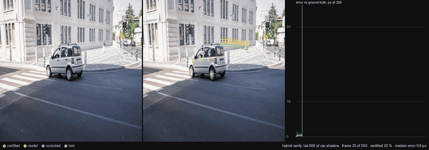

# Certified Anchored Tracking

Point tracks where a step can carry a proof, and a measured answer to whether that helps a
learned tracker. It does not, on the footage tried here, and the reason is worth knowing.



Every query point keeps the raw-pixel template of its query frame. On each new frame the
template is matched and the match is **certified** with the multi-scale box test of
[certified-skip](https://github.com/nsquaredzz/certified-skip) (Theorem 3 there): while a
step is certified, no feature of contrast Δ_r that contains a (2r+1)-box appeared, vanished,
split or merged in the template's footprint, up to one brightness offset. A certified step is
anchored to the query frame, so its error does not accumulate with time. Steps that do not
certify are handed to a frozen learned tracker, CoTracker3, whose proposal is checked against
the same template before it is believed.

## What was found (2026-10-14, one day, details in RESULTS.md)

On TAP-Vid DAVIS at 256x256, six fixed development clips:

- **The certificate is precise and sparse.** With a 21 px template and Δ_0 = 80 it fires on
  10-12 % of frames whose ground truth is visible, on 1-4 % past 30 frames from the query;
  93-100 % of certified steps are within 4 px of the truth and none fall on an occluded frame.
  Certifying at the ground-truth position gives the same share, so the search is not the
  limit; a similarity or affine fit adds one to three points. Loosening the threshold or
  shrinking the template buys coverage and pays in certified impostors.
- **The self-match set does what the theorem says.** Among certified steps, those whose
  template certifies against itself at no shift of two pixels or more are within 4 px of
  the truth 97-100 % of the time; the rest 40-65 %. "Certified in place" has operational
  content on exactly the templates Theorem P names (THEORY.md §3).
- **The brightness offset matters more than the warp group.** The exact minimiser of the
  multi-scale score has a closed form (THEORY.md §1); the midrange, which certified-skip's
  range rule uses, is thrown off by a few extreme pixels and certified 4 % of the frames the
  exact offset certifies.
- **The hybrid equals its backbone to the decimal.** CoTracker3 alone and CoTracker3 with
  the certificate as verifier give the same AJ / δ_avg / OA on the short clips (71.9 / 85.1 /
  91.5) and on 500-frame palindromes (60.5 / 80.1 / 83.7), where the model does not drift
  (99 % of points within 16 px at the end). The certificate never fired on a frame where the
  model was wrong. CoTracker3 is itself anchored to the feature of its query frame, in a
  space that tolerates deformation, blur and lighting; a raw-pixel template modulo a warp and
  an offset tolerates less, so it fails first.

So this is not a tracker and it does not improve one. What it is: a sparse, checkable flag
with a theorem behind it, an exact offset the multi-scale test should always have used, the
self-match set as the right object for position error under a certificate, and a clean
negative result on where raw-pixel certificates stand relative to a learned tracker.

| method, dev-6 | AJ | δ_avg | OA |
|---|---|---|---|
| CoTracker3 online, joint queries, MPS | 71.9 | 85.1 | 91.5 |
| hybrid: CoTracker3 + certificate, 21 px, Δ_0 80, gated | 71.9 | 85.1 | 91.5 |
| certified carry alone, same setting | 11.8 | 31.1 | 32.4 |

All 30 clips, CoTracker3 alone: 64.5 / 77.2 / 90.8 in 142 s on an Apple M4 (the paper's
single-point protocol gives 63.8).

## Reproduce

```
python3.12 -m venv .venv && .venv/bin/pip install -e ../certified-skip -e '.[dev,model]'
.venv/bin/python scripts/fetch_data.py            # TAP-Vid DAVIS 1.67 GB, RGB-Stacking 187 MB, SHA-256 checked
.venv/bin/python scripts/fetch_weights.py         # CoTracker3 weights 2 x 100 MB, pinned source checkout
.venv/bin/python scripts/prepare_tapvid.py        # per-clip files at 256x256
.venv/bin/python -m pytest -q                     # 24 tests, no data or torch needed
.venv/bin/python scripts/bench_tapvid.py --method cotracker --set all
.venv/bin/python scripts/e1_certified_fraction.py --set dev6
.venv/bin/python scripts/bench_tapvid.py --method hybrid-verify --set dev6 --side 21 --delta0 80
.venv/bin/python scripts/bench_long.py --method hybrid-verify --set dev6 --length 500 --kind tail
.venv/bin/python scripts/render_proof.py data/runs/<stem>/<clip>.npz --clip <clip> --out out/<name>.mp4
```

`certified-skip` must be checked out beside this repository; it supplies the certificates
(`certskip.scalespace`, `certskip.warpcert`, `certskip.topology`). Nothing larger than the
GIF above is in git: data, weights and runs live under `data/` (ignored), videos under
`out/*.mp4` (ignored); `out/*.json` and `out/*.txt` carry every number with the machine and
the call log.

## Layout

```
python/certtrack/
  data/        TAP-Vid pickle -> per-clip npz; tapnet's query sampling verbatim; DAVIS and footage readers; palindromes
  metrics.py   tapnet's compute_tapvid_metrics verbatim, plus wrappers
  longmetrics.py  survival, median trajectory error, re-detection AJ, certified fraction, proof precision
  track/       template (gradients, kappa, self-match set), camera prior, integer search, certificate with the exact
               offset, warp fit (translation / similarity / affine), tracker with the verify mode
  models/      CoTracker3 behind one protocol; a fake tracker for tests
  methods.py   carry-only, hybrid-verify, frozen-only
  harness.py   run and score; out/<stem>.{json,txt}
  render.py    proof videos
scripts/       fetch_data, fetch_weights, prepare_tapvid, bench_tapvid, bench_long, e1_certified_fraction, render_proof
tests/         metrics hand cases, loaders, certificate invariants (bit-exact with certskip on a fixed camera), synthetic end to end
```

## What is new, what is not, what is missing

**Not new.** Lucas-Kanade (1981) and Shi-Tomasi (1994), including their check against the
first-frame template; Baker and Matthews' inverse-compositional fit (2004); Matthews, Ishikawa
and Baker, "The template update problem" (2004), which re-aligns to the first template and
rejects drift past a threshold, the direct ancestor of anchoring; block matching and pyramids;
failure detection and re-detection in MOSSE and TLD; MFT (2024); learned verifiers for tracker
output (2026); the stability theorem for persistence diagrams (2007); send-on-delta.

**New, to my knowledge.** A per-step certificate on raw pixels for a point track, with a
topological reading and a tightness construction, evaluated at integer positions so no
interpolation term enters; the exact brightness offset for the multi-scale test; the
self-match set of a template as the object that bounds position error under a certificate,
and its use as a gate; the bookkeeping that says which proofs survive re-anchoring; and the
measurement that none of it moves a learned tracker on this footage, with the reason.

**Missing / not claimed.** Identity under repetitive texture or look-alikes (the certificate is
existence, not uniqueness); deformation, out-of-plane rotation and lighting beyond gain and
offset; any guarantee while a point is model-held or occluded; benchmark leadership on
anything; long real footage with ground truth (RoboTAP would be the venue; not run); the
compute axis (with the certificate firing on 5-10 % of frames, a gate cannot save more).

## Licence

MIT for this code. TAP-Vid, DAVIS, RGB-Stacking and the CoTracker3 weights stay under their own
terms and are fetched from their owners' servers, never redistributed here.
